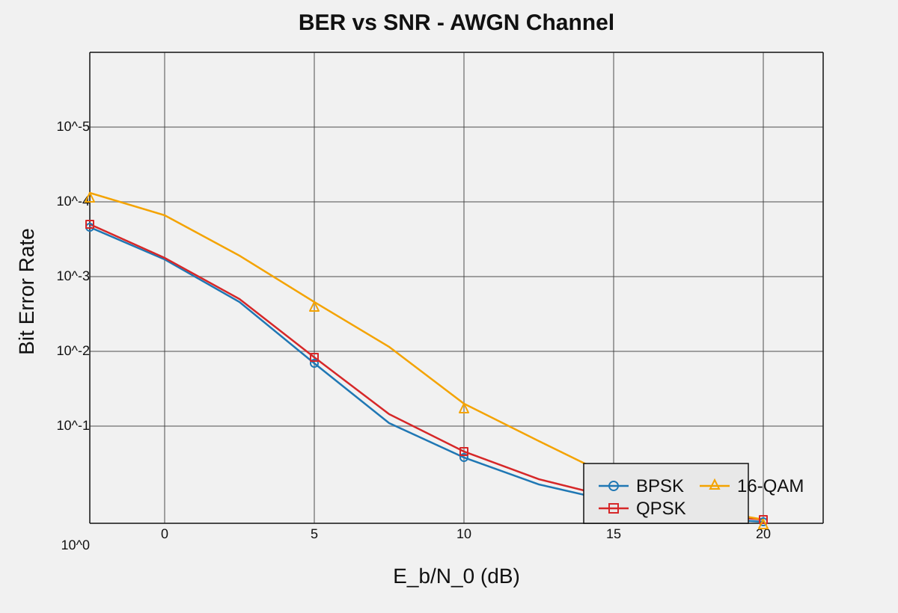
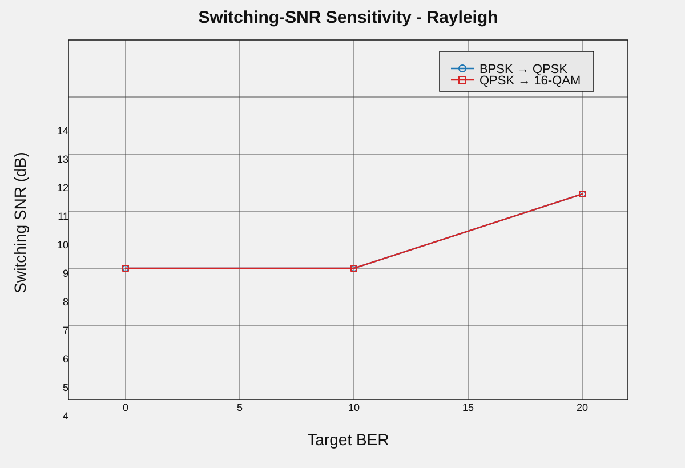
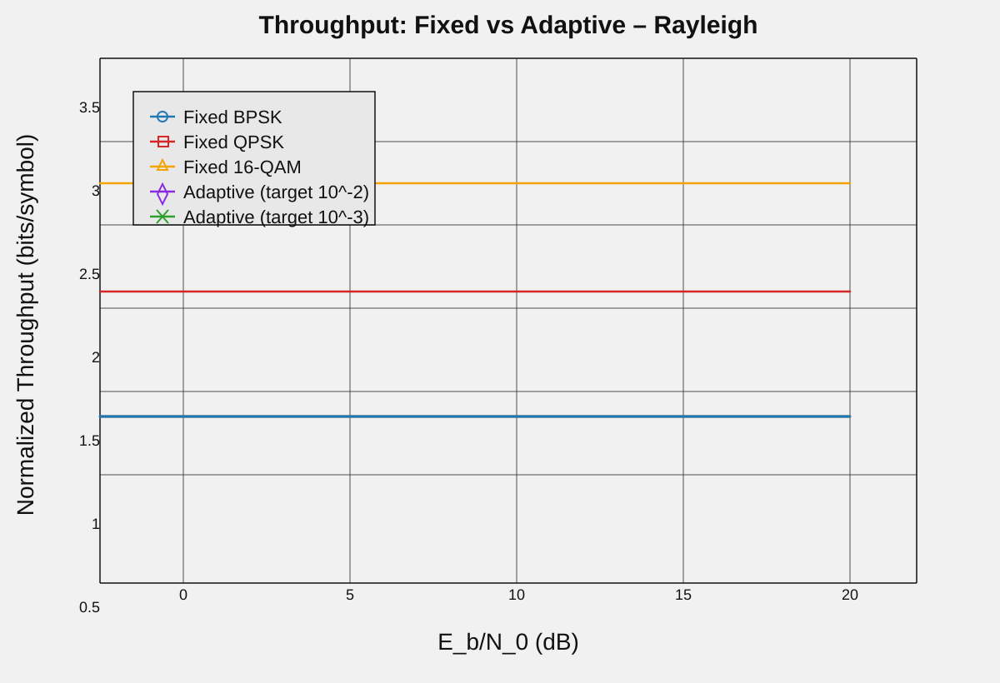

# Target-BER Based Adaptive Modulation for Wireless Communication Systems

This project simulates adaptive modulation for wireless communication links using BPSK, QPSK, and 16-QAM over AWGN and Rayleigh fading channels. The transmission mode is selected dynamically to maintain a target bit error rate (BER) while maximizing spectral efficiency and throughput.

## Overview

The simulation compares:

- BER performance versus SNR for AWGN and Rayleigh channels
- Adaptive modulation switching thresholds
- Throughput performance of fixed versus adaptive modulation
- Robustness under varying switching SNR conditions

## Key Features

- Adaptive modulation selection based on target BER
- Support for BPSK, QPSK, and 16-QAM
- AWGN and Rayleigh channel models
- MATLAB-based simulation workflow
- Plot generation and result export in the `Results/` folder

## Repository Structure

- `main.m` — main entry point for the simulation
- `run_ber_sweep.m` — BER sweep calculations
- `adaptive_select.m` — modulation selection logic
- `compute_throughput.m` — throughput calculations
- `Results/` — output plots and result files

## How to Run

Open MATLAB in the project directory and run:

```matlab
main
```

You can also run:

```matlab
run('main.m')
```

## Results

The generated plots are stored in the `Results/` folder.

### BER vs SNR




### Switching SNR Sensitivity




### Throughput Comparison




## Notes

This project is useful for studying how adaptive modulation improves link reliability and efficiency in fading wireless environments, especially when channel quality varies over time.
